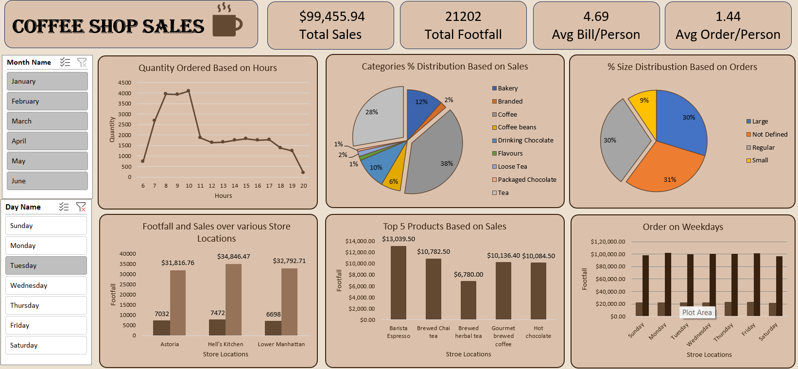

# ☕ Coffee Shop Sales Analysis| Microsoft Excel

## Project Overview
The Coffee Shop Sales Analysis Dashboard is an interactive Excel-based data analytics project designed to evaluate sales performance, customer footfall, product demand, and ordering patterns across multiple store locations. The dashboard transforms sales data into meaningful visual insights to help businesses monitor performance and make data-driven decisions.This project analyzes coffee shop sales data to understand customer behavior, product performance, and revenue trends.

The goal is to extract meaningful insights that can help improve sales strategies, optimize operations, and enhance customer experience.

## Problem Statement
Coffee shops generate sales data across different products, store locations, hours, and days. However, analyzing this information manually can make it difficult to identify peak sales periods, top-performing products, customer ordering patterns, and differences in store performance.

The objective of this project is to develop an interactive Excel dashboard that consolidates key sales metrics and visualizes business performance. It enables users to explore sales trends, compare store locations, identify popular products, and understand ordering behavior to support better business planning and operational decisions.
The coffee shop lacks clarity on:
- Which products generate the most revenue  
- Peak sales hours and customer demand patterns  
- Underperforming products  
- Sales trends across time  

This leads to inefficient decision-making and missed growth opportunities

## Project Objectives
- Monitor overall sales performance and customer footfall.
- Identify peak hours based on order quantity.
- Analyze sales contribution by product category.
- Identify the top 5 products based on sales.
- Compare sales and footfall across store locations.
- Understand order-size distribution and weekday ordering patterns.
- Enable dynamic analysis using interactive month and day filters.

## Key Performance Indicators (KPIs)
- **Total Sales:** $99,455.94
- **Total Footfall:** 21,202
- **Average Bill per Person:** 4.69
- **Average Orders per Person:** 1.44

## Dashboard Features
- **Hourly Order Analysis:** Visualizes quantity ordered across different hours.
- **Category-Wise Sales Analysis:** Displays the percentage contribution of product categories.
- **Order-Size Distribution:** Analyzes the distribution of large, regular, small, and undefined orders.
- **Store Performance Analysis:** Compares sales and customer footfall across store locations.
- **Top 5 Products:** Highlights products with the highest sales.
- **Weekday Analysis:** Visualizes ordering patterns across the week.
- **Interactive Filters:** Allows users to filter dashboard results by month and day of the week.

## Tools & Technologies
- Microsoft Excel
- Data Analysis
- Data Visualization
- KPI Reporting
- Interactive Dashboard Development
- Sales Trend Analysis

## Business Value & Insights
This dashboard provides a consolidated view of coffee shop performance and helps business stakeholders:
- Monitor sales and customer activity.
- Understand product demand and sales contribution.
- Compare store-level performance.
- Explore hourly and weekday ordering patterns.
- Support data-driven decisions related to product planning, staffing, and business operations.

## Author
**Prajakta Bhondave**

Aspiring Data Analyst | Excel | SQL | Power BI | Python

[Connect with me on LinkedIn](https://www.linkedin.com/in/prajakta-bhondave-773b092a6)
